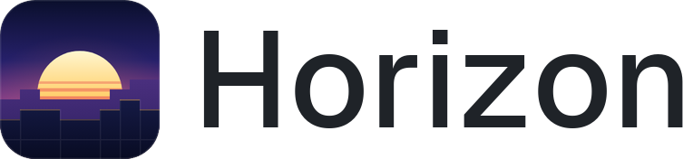

  <picture>
    <source media="(prefers-color-scheme: dark)" srcset="docs/media/readme/title-dark.png">
    
  </picture>

  <b>Horizon for iPhone and iPad.</b> 
  Minecraft: Java Edition 26.3, rewritten in Rust, running natively on iOS. No JIT, no Java.

  <a href="https://github.com/MrStickman202/Horizon-rust-ios/releases/tag/latest"><b>Download Horizon.ipa</b></a> ·
  <a href="#install">Install</a> ·
  <a href="#add-your-game-files">Game files</a> ·
  <a href="#controls">Controls</a> ·
  <a href="https://github.com/ludovic111/horizon">Horizon (desktop)</a>

  

This is an unofficial port of [Horizon](https://github.com/ludovic111/horizon) to iOS and iPadOS,
sideloaded like Amethyst. The game is compiled ahead of time, so it runs without JIT on any
sideloading method.

## What you get

- **Vanilla Minecraft: Java Edition 26.3:** survival, creative and hardcore, the same terrain, mobs and
  redstone. Singleplayer, LAN and Java servers.
- **A home screen** in Horizon's look: Play, your worlds, installed mods, saved servers, resource
  packs, shaders, screenshots and the log.
- **Microsoft sign-in** to play online as your account, or play offline with a name you pick.
- **Touch controls** in four layouts (joystick, joystick with crosshair, D-pad, Horizon's own), with a
  layout editor: move, resize, hide and add buttons.
- **Keyboard, trackpad, mouse and controllers:** an iPad keyboard case, the Magic Keyboard, Bluetooth
  mice, and Xbox, PlayStation and MFi controllers.
- **Content mods** from Horizon's catalogue: in the game, Options › Mods › Browse mods.

Not on iOS: native (code) mods, which iOS doesn't allow an app to build and load, Discord
presence, and the desktop launcher's shop, wardrobe and version picker.

## What you need

- **Your own copy of Minecraft: Java Edition.** Horizon ships no Minecraft files. They're prepared
  once from the game you bought, on a computer (below).
- **An iPhone or iPad on iOS 15 or later.** An M1 iPad runs it well.
- **A Mac or PC** once, to prepare the game files with the Horizon launcher.

## Install

1. Download `Horizon.ipa` from the [latest release](https://github.com/MrStickman202/Horizon-rust-ios/releases/tag/latest).
2. Install it with a sideloading tool: AltStore, SideStore, Sideloadly or TrollStore. The .ipa is
   unsigned, so the tool signs it with your Apple ID.
3. With a free Apple ID, reinstall or refresh it every 7 days (AltStore and SideStore can do this
   for you).

## Add your game files

1. On your Mac or PC, install the [Horizon launcher](https://playhorizon.dev/download), sign in and
   press Play once. That prepares the game files from your Minecraft.
2. Find the prepared `26.3` folder:
   - macOS: `~/Library/Application Support/horizon-launcher/versions/<version>/.local/horizon-client/26.3`
   - Windows and Linux: the same `.local/horizon-client/26.3` path in the launcher's folder.
3. Copy that `26.3` folder to your device (AirDrop or Finder), then in the Files app move it to
   **On My iPad › Horizon** (On My iPhone on a phone).
4. Open Horizon. If the folder isn't found, the app says where it looks.

Resource packs go in `Horizon › resourcepacks`, shader packs in `Horizon › shaderpacks`. Your
worlds, screenshots and logs are in the same folder, so the Files app can back them up.

## Microsoft sign-in

Settings › Sign in with Microsoft shows a code, copies it, and opens Microsoft's sign-in page. Paste
the code, sign in, and come back. The home screen then lets you choose **Online** (your account:
online-mode servers, your skin, signed chat) or **Offline** (your offline name).

Your account's tokens are kept only in your device's Keychain and never leave it except to
Microsoft and Mojang. Sign out forgets them. The app never asks for your password: you type it on
Microsoft's own page.

## Controls

**Touch.** The controls show when you touch the screen and hide when you use a keyboard or a
controller. To bring them back at once, touch the screen with two fingers, one on each half. The Edit
button opens the layout editor, where Controls switches between the four layouts (in Horizon's own
layout, the Touch button does). Over chat and inventories, the back arrow at the top left closes
them.

**Keyboard.** The same keys as on a computer. Most iPad keyboards have no F keys: hold **Cmd** with
a digit instead. Cmd+1 to Cmd+0 are F1 to F10, Cmd+- is F11 and Cmd+= is F12 (Cmd+3 is the F3
debug screen, Cmd+5 changes the camera).

**Trackpad and mouse.** In a world the pointer locks and turns the camera; in menus it clicks and
scrolls as usual.

**Controllers.** Work in menus and in the game, as on a computer.

## Privacy

Every .ipa is built by GitHub Actions from this repository's public code. It contains no one's
accounts, tokens, worlds or Minecraft files: each player's sign-in stays on their own device. The
Microsoft app ID in the app (`928164ca-93c9-4361-82d2-c740023f96f0`) is public by design; there is
no client secret. More in [ios/README.md](ios/README.md).

## Building it yourself

The [iOS workflow](.github/workflows/ios.yml) builds the app on a macOS runner:
`cargo build --profile fast --target aarch64-apple-ios -p horizon-ios`, then packs
`Payload/Horizon.app` into an unsigned .ipa. The iOS-specific code is in `crates/horizon-ios`,
`ios/`, and the patched `winit` in `third_party/winit`.

## Credits

Horizon is made by the Horizon Team: Kacper, Cosmic, levzzz, rdbt, Anthony S, Nikita and Ludovic
Marie (founder), with [everyone who has contributed](https://github.com/ludovic111/horizon/graphs/contributors).
This repository is an unofficial iOS port of their work and isn't run or supported by them: please
report iOS problems [here](https://github.com/MrStickman202/Horizon-rust-ios/issues), not on
Horizon's tracker.

Horizon is released under the [GNU LGPL, version 3 or later](LICENSE); code merged before its move from MIT stays available under the [MIT licence](LICENSES/MIT.txt). This port keeps that licence, and its changes are this repository's history. Dependencies keep their own licences, see the [notices](THIRD_PARTY_NOTICES.md).

NOT AN OFFICIAL MINECRAFT PRODUCT. NOT APPROVED BY OR ASSOCIATED WITH MOJANG OR MICROSOFT. Minecraft is a trademark of Mojang Synergies AB; its code and assets belong to Mojang and Microsoft under the [Minecraft EULA](https://www.minecraft.net/en-us/eula).
